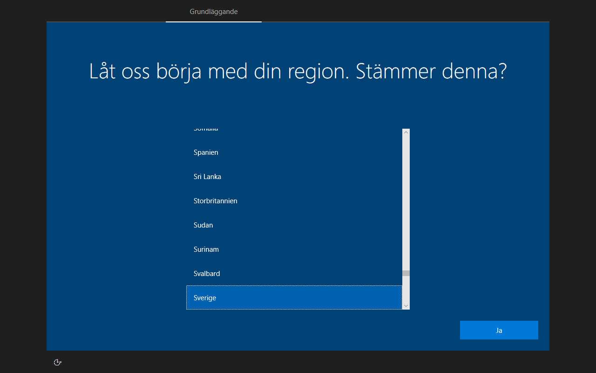

# FlexBoot 0.7.0 validation — 2026-10-14

This pass tests release `0.7.0` (commit `688c6f6`) using an existing 128 GB
Windows-enabled USB drive. The application code was unchanged during testing.

## What the test establishes

QEMU/OVMF booted the actual data on the physical USB through explicitly read-only
block nodes. Each guest had a separate writable overlay, two virtual CPUs,
4 GiB RAM, no network interface, and Secure Boot disabled. The drive used the
512 MiB FAT32 Basic Data boot partition, ext4 Linux storage, and 12 GiB NTFS
Windows storage. Destructive installation operations targeted owned virtual disk
files; the USB was not reformatted or repartitioned.

These results establish boot behavior with OVMF and an emulated USB controller.
They do not establish native machine firmware/controller compatibility. Secure
Boot, BIOS, ARM64, and other Windows installer families remain outside this pass.
Locally recorded hash matches establish stored integrity, not publisher authenticity.

## Checks

| Check | Result |
|---|---|
| Standard-library suite, including both privileged loop-image integration cases | 146 passed, no skips |
| Full USB inspection | All ISO hashes, detected Linux boot plans, Windows resources, runtime hashes, filesystem identities, metadata, and generated menus consistent |
| FAT32 `fsck.fat -n` | Passed without repairs |
| ext4 `e2fsck -f -n` | All five passes completed without repairs |
| NTFS `ntfsfix -n` | Basic volume, MFT mirror, and alternate boot-sector checks passed; this is not a full Windows chkdsk scan |
| GRUB firmware setup | Native OVMF firmware settings reached |
| GRUB reboot | Returned to FlexBoot; firmware recorded a second boot |
| GRUB shutdown | Guest powered off |
| Python compilation and whitespace checks | Passed |

## Linux boot matrix

Each entry booted its intact ISO from the USB and reached a usable live
environment or installer UI. Starting the kernel alone was insufficient to pass.

| Supplied ISO | Observed result |
|---|---|
| `clonezilla-live-3.3.3-37-amd64.iso` | Start Clonezilla / Enter shell screen |
| `Fedora-Workstation-Live-44-1.7.x86_64.iso` | GNOME desktop and Fedora welcome screen |
| `kali-linux-2019.3-amd64.iso` | Live desktop |
| `kali-linux-2022.2-live-amd64.iso` | Live desktop |
| `kali-linux-2026.2-live-everything-amd64.iso` | Live desktop; approximately 16.5 GB ISO |
| `rescuezilla-2.6.2-64bit.resolute.iso` | Rescuezilla application welcome screen |
| `ubuntu-26.04.1-live-server-amd64.iso` | Subiquity language-selection screen |

This covers the specific supplied images, not every release in each family.
The 2019 Kali image qualified through its live contents rather than its filename.
Installer-only Kali images remain outside that profile.

## Windows

The supplied Windows 10 22H2 Swedish WIM-based image reached native Setup and
detected the blank 64 GiB virtual destination. No manually selected system-store
path, precreated destination partitions, or hardware-check bypass was used.

Full installation completed. With the USB disconnected from the guest, the
virtual destination booted its own Windows Boot Manager and reached first-run
region selection. No further installer source was required.

The capture is directly from QEMU. It shows the independently booted destination,
not Windows PE or the installer. The first mechanical-disk destination test was
stopped while progressing slowly; the completed installation used a fresh
SSD-backed virtual disk. USB data-sector write counters remained at zero.
All guests and temporary mounts were stopped or cleaned up after testing.

Earlier [Windows 10/11 installation results](WINDOWS-EXPERIMENTS.md) remain
separate from this USB-backed test.

## Follow-up hardware observation

On 2026-10-15, the user reported successfully booting a physical machine to all
eight images on this USB. This is user-reported native hardware validation of
that drive and machine, separate from the automated QEMU/OVMF results above.
It does not establish Secure Boot or universal firmware compatibility.
