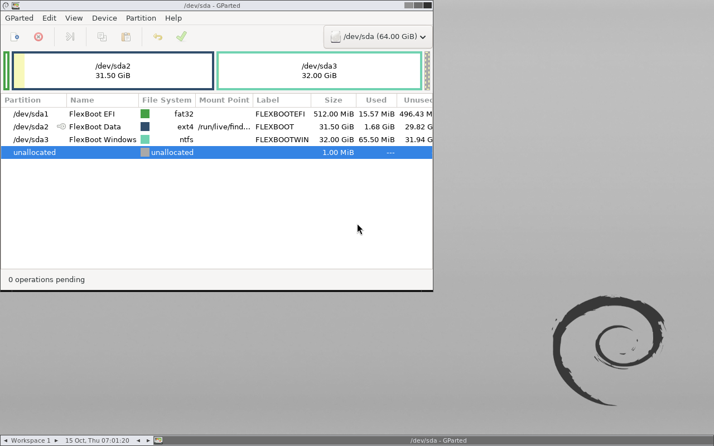
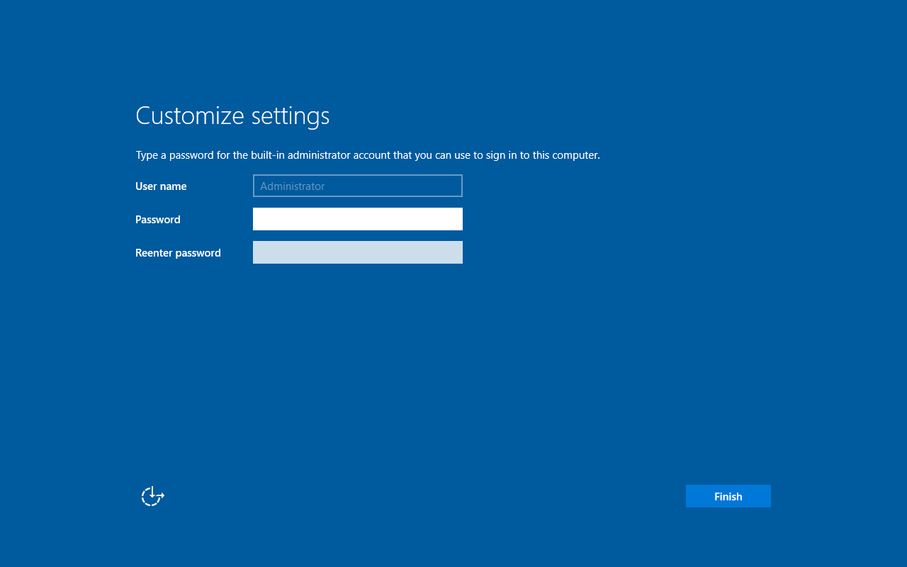

# FlexBoot 0.7.2 compatibility validation — 2026-10-15

This pass expands Linux profiles and the eligible Windows PE build range. It
uses intact user-supplied ISOs copied from the authorized ISO library. Locally
recorded hashes establish integrity, not publisher authenticity.

The user separately reported successfully booting a physical machine to all
eight images on the existing USB. That observation is recorded in the
[0.7.0 validation report](TESTING-0.7.0.md). The additional images below were
tested on disposable raw images under QEMU/OVMF, with no physical-disk changes.

## Test environment

The combined 64 GiB image has 512 MiB FAT32 Basic Data boot storage, ext4 Linux
storage, and 32 GiB NTFS Windows storage. Host GRUB 2.14 installs the removable
UEFI path. Windows uses the same locally supplied NTloader 3.0.7 and locally
built FlexBoot ISO-mount helper as the earlier installation tests. No runtime
binary is downloaded by FlexBoot or committed to the repository.

Guests use x86-64 UEFI, two CPUs, 4 GiB RAM, an emulated removable USB controller,
Secure Boot disabled, and no network interface. Installer destinations are owned
virtual disk files. Source media is locked and read through snapshot overlays;
full installation results require a subsequent destination-only boot.

## Linux

| Image | Result |
|---|---|
| Slax 12.2 amd64, stored as `Slax with spaces.iso` | Live desktop; intact ISO found through the checked safe boot alias and Linux Live Kit `from=` |
| GParted Live 1.8.1-3 amd64 | Desktop and GParted application |
| Parrot Security 7.2 amd64 | Live graphical desktop after entering the live session |

GParted initially matched generic Debian Live and failed desktop autologin. Its
new dedicated profile supplies the vendor's explicit `username=user` argument.
Parrot keeps `noautomount` and `noeject`; neither profile requests persistence.
Slax also omits persistence and automount options. No partition operations were
performed in the GParted guest.

## Windows installer tests

All three selected Windows ISOs coexist on the same NTFS partition and have
separate prepared boot resources in the shared menu.

| Supplied image | Observed result |
|---|---|
| Windows Server 2019 Evaluation, 17763.3650 media | Standard Evaluation Desktop Experience installed to a blank virtual disk; destination-only UEFI boot reached first-run administrator setup |
| Windows Server 2022, 2108.23 x64 media | Native Setup, correct Server editions, license/custom-install flow, and blank 64 GiB destination detected; full installation not tested |
| Windows 10 1803 Enterprise Evaluation, 17134.1 media | Native Setup, license/custom-install flow, and blank 64 GiB destination detected; full installation not tested |

No destination partitioning workaround or manual system-store selection was
used. The Server 2022 and Windows 10 1803 tests stopped at destination selection
without starting an installation. A Setup-launch result does not establish a
completed installation.

The Windows 10 1803 diagnostic shell reported PE version `10.0.17134.1`.
Its log recorded exactly one source volume, the selected Enterprise Evaluation
WIM, successful DISM inspection, and `PAYLOAD_VALIDATED`. Opening that optional
shell also printed a memory-resources warning; subsequent diagnostic commands
succeeded. This pass does not establish a full 1803 installation.

Server 2019 completed native installation without a destination-partitioning
workaround. After its first reboot, the installer VM was stopped. A new guest
attached only the installed destination and reused its saved OVMF variables.
Firmware loaded that disk's `Windows Boot Manager` and reached the initial
administrator-password setup screen. No USB source, ISO, or virtual CD-ROM was
attached; no account password or service configuration was completed.

## Windows build boundary

The previous build floor of 19041 excluded potentially compatible Windows 10
and Server installers. The accepted minimum is now 15063 (Windows 10 1703),
following Microsoft's [multi-partition USB requirements](https://learn.microsoft.com/en-us/windows-hardware/manufacture/desktop/winpe--use-a-single-usb-key-for-winpe-and-a-wim-file---wim?view=windows-11).
Eligibility still requires x64 Setup at boot WIM index 2, `install.wim`, the
explicit Windows media layout, and the audited local runtime.

An experimental Windows 8.1 PE 9600 boot exposed only the first FAT32 source
partition; the NTFS source was unavailable. Startup safely refused before Setup.
A diagnostic fixed-media emulation control reached Windows 8.1 Setup, confirming
that native ISO API availability alone does not solve removable-media partition
access. This is not Windows 8.1 support and no fixed-media option is exposed by
FlexBoot. Windows 7/8/8.1 and Server 2016 or earlier PE remain excluded.

## Automated checks

- All 152 standard-library tests passed inside the isolated root container,
  including both actual loop-image integration tests, with no skips.
- The unprivileged run passed with the two privileged integration cases skipped.
- Full combined-image verification passed with ISO hashes checked and no problems.
- Python compilation, CLI/version and image dry-run checks, and an offline wheel
  build passed. The wheel contains the new profiles and helper source, with no
  bootloader executable, Microsoft binary, ISO, or local coding instructions.
- An interrupted Windows import on a separate disposable image cleaned up its
  staging files and mounts. Subsequent full verification passed without problems.

## Scope

These are release-specific observations, not a guarantee for every ISO in each
family. New-image hardware validation remains pending. Secure Boot, BIOS,
ARM64, ESD/split-WIM installers, arbitrary custom PE, and automatic destination
selection remain outside this work.
