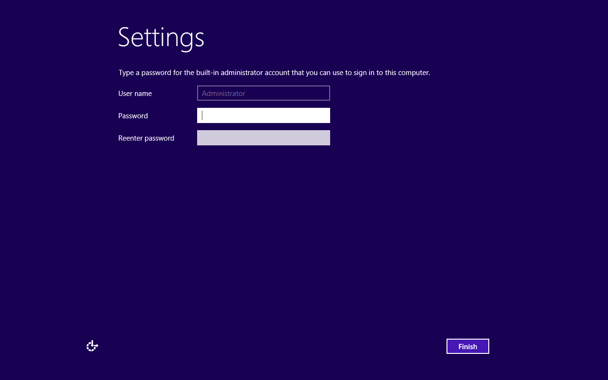
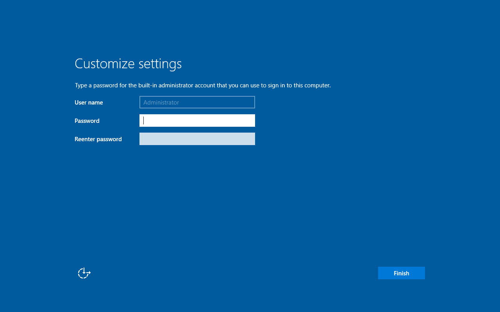

# Older Windows validation — FlexBoot 0.7.3

This pass tests an explicit newer-WinPE boot environment with older x64 installer
ISOs. Source images are user-supplied. Local hashes record integrity, not source
authenticity. All installation destinations are disposable virtual disk files;
no physical partition tables or filesystems are changed.

## Method

A 32 GiB raw image uses the existing Windows-enabled Basic Data FAT32/ext4/NTFS
layout. Each test image contains one older Windows entry. Server 2016 uses a
separate copy so the installation tests can overlap. Windows 10 1803 PE
(17134.1) supplies the boot WIM, SDI and EFI resources.
The older ISO remains intact on NTFS. Its own `sources/setup.exe` receives its
own `sources/install.wim` explicitly after native read-only ISO attachment.

QEMU/OVMF uses x86-64 UEFI and four CPUs. RAM is 6 GiB for the Server 2012 R2
installer and 4 GiB for Server 2016 and independent boots. Installation VMs have
no NIC, Secure Boot disabled, and a snapshot of the source USB image. Destinations are owned 64 GiB sparse
files. Independent-boot tests start a fresh VM with only the installed target
and saved OVMF variables, without any installer source or virtual CD-ROM.

## Results

| Image | Validation |
|---|---|
| Server 2012 R2 Evaluation x64 | Standard GUI completed installation; fresh destination-only VM reached Administrator password setup |
| Server 2016 Evaluation x64 | Standard Desktop Experience completed installation; fresh destination-only VM reached Administrator password setup |
| Server 2012 x64 | Not tested; source unavailable during this run |
| Windows 7 x64 | Supplied file is an MBR/FAT32 disk image, despite its `.iso` extension; not accepted as an ISO and not boot-tested |

The Windows 7 file was inspected read-only on the source host before access was
lost. Its Setup executable is x64 and its file dates correspond to the RTM era;
no SP1 compatibility result is claimed. Any derived optical ISO used in a future
lab experiment must be identified as such and preserve the original source.

## Firmware boundary

A private CSM-enabled OVMF was built from EDK II `edk2-stable202211` and SeaBIOS
`rel-1.16.3` for possible Windows 7 firmware testing. It is not shipped, installed
on hardware, or required by FlexBoot runtime. Building the firmware is not a
Windows 7 boot result. Windows 7's documented CSM requirement remains relevant
when the installed OS starts, even if modern WinPE can access the source USB.

## Integrity and failure handling

Borrowed boot environments require explicit `--winpe-from`. Default native
preparation retains the WinPE 1703 minimum. Schema-2 metadata records donor
provenance and the older installer build; prepared files remain independently
hashed. Changing a donor requires replacement, and failed or interrupted staging
must not publish a new image. Source mutation, invalid architecture/build,
malformed provenance, renamed disk/archive inputs, and dry-run behavior are
covered by regression tests.

## Regression and packaging checks

All 158 tests passed: 156 regular tests and both explicitly enabled privileged
loop-image integrations. The 49 Windows tests were repeated after final CLI
cleanup and passed. Python compilation, CLI help/version, dependency diagnostics,
read-only device discovery, and source-only dry-run checks completed. The 0.7.3
wheel built with `--no-index --no-deps --no-build-isolation`; its inventory contains
no local instructions, credentials, loader binary, Microsoft executable, WIM or
ISO. Source-media verification includes recorded hashes and generated menu state.

No physical storage was modified. Hardware booting of these older releases,
Server 2012 installation, and Windows 7 installation remain untested.

