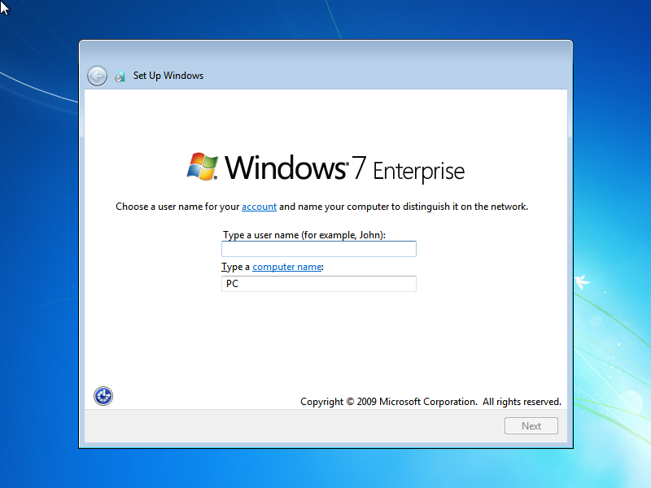
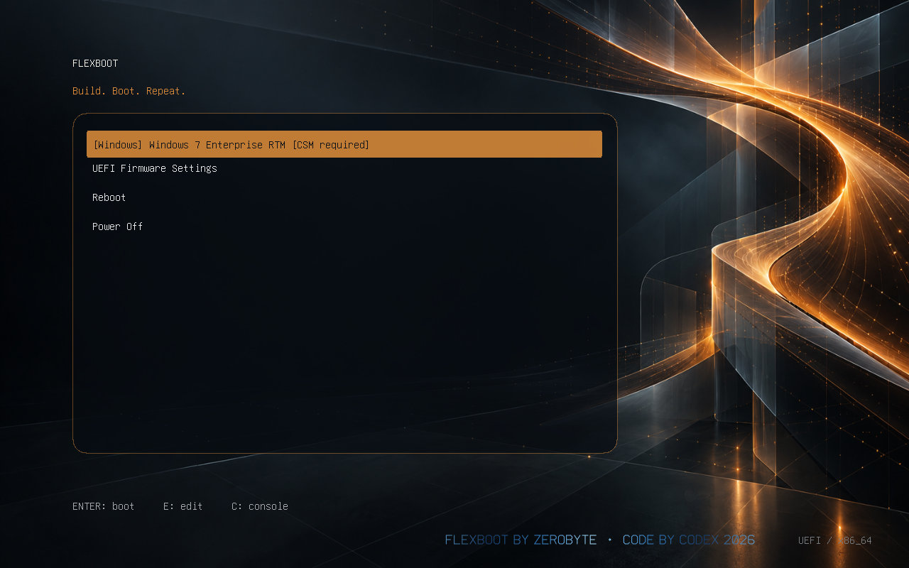
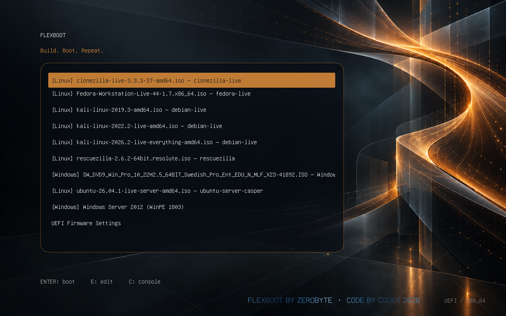
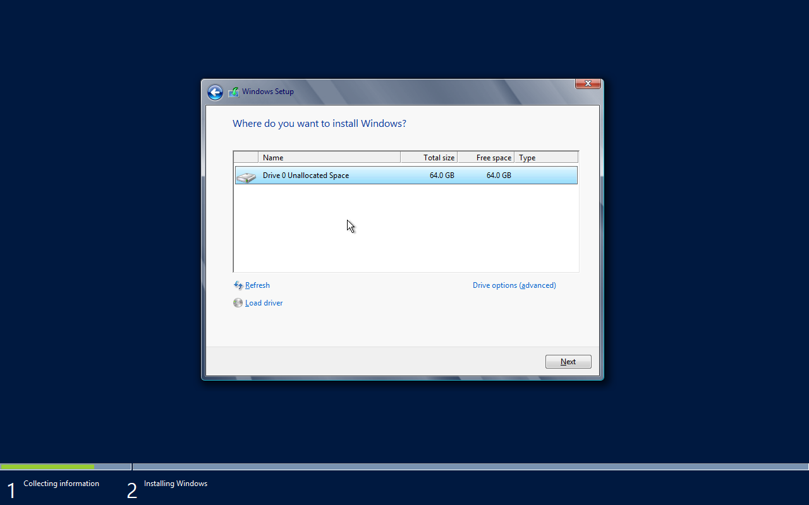
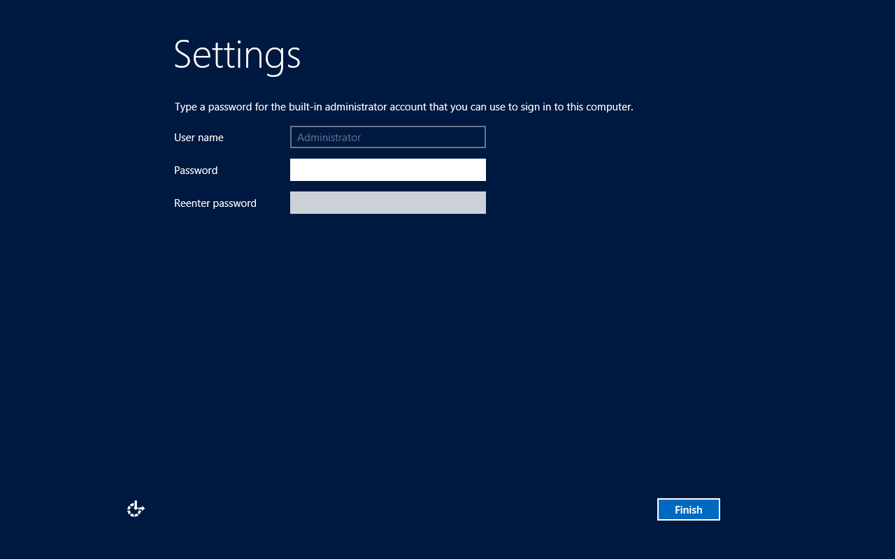

# FlexBoot 0.7.4 — older Windows and USB follow-up

This follow-up uses the supplied Server 2012 and Windows 7 media. All installation
destinations are owned disposable virtual disk files. The existing Samsung
128 GB FlexBoot USB is reserved for explicit media preparation and read-only
USB-backed boot tests; its partition table and existing images are preserved.

## Sources and method

Server 2012 Standard Evaluation x64 uses its intact installer ISO and the
existing `--winpe-from` preparation path with Windows 10 1803 WinPE (17134.1).
Its own Setup executable receives its own installation WIM.

The supplied Windows 7 file is an MBR/FAT32 USB disk image, despite its `.iso`
extension. The normal application rejects it. A private derived ISO contains
only its Windows installer files; unrelated top-level files are excluded. The
original image remains unchanged, checked by SHA-256 before and after derivation.
The installation WIM identifies Windows 7 Enterprise x64, build 7600.16385,
service-pack level 0. No Windows 7 SP1 result is implied.

The initial Windows 7 experiment overrides the minimum installer build only
inside the private lab process. After independent boot succeeded, the application
gained an explicit `--allow-windows7-csm` option requiring `--winpe-from`.
The default gate remains unchanged. Preparation validates architecture, hashes,
source identity, resource inventories and generated configuration. No modified
Microsoft binary or firmware is distributed.

QEMU uses four CPUs, 4 GiB RAM for Server 2012 and 6 GiB for the Windows 7
installer, no NIC and snapshot-protected installer storage.
Each destination is a fresh 64 GiB sparse file. An independent-boot pass requires
a fresh VM with only the installed destination and saved firmware variables;
installer USB and CD-ROM devices must be absent. Windows 7 additionally needs a
GPT/UEFI check and a compatible CSM firmware test. The private source-built
firmware uses EDK II `edk2-stable202211` and SeaBIOS `rel-1.16.3`.
The installed Windows 7 guest uses 4 GiB RAM. SSD-backed source and destination
files avoid the severe mechanical-disk contention observed in preliminary runs;
those interrupted preliminary runs are not counted as compatibility failures.

## Installation results

| Image | Result |
|---|---|
| Server 2012 Standard Evaluation with GUI | Full installation completed; fresh destination-only VM reached Administrator password setup |
| Derived Windows 7 Enterprise x64 RTM installer | Full installation completed; destination-only CSM-enabled VM reached account/computer-name setup; GPT partition table verified |

The tested Windows 7 installation uses the original runtime, the donor WinPE's
normal system libraries, and the selected ISO's own Setup. No API shim or custom
deployment engine was required. Modern WinPE support does not remove the
installed system's firmware or driver requirements. Windows 7 SP1 and native
hardware installation remain untested.

A fresh 16 GiB raw image was also prepared through the actual application CLI.
Adding the Windows 7 source without the new flag was rejected and rollback
verified cleanly. Adding it with the flag and donor passed full resource/hash
verification. Its aliased boot entry retains the firmware annotation:

That image also booted under CSM firmware and reached native Windows 7 Setup's
blank 64 GiB destination selection. No second installation was started in this
pass; the full installation and destination-only boot result is the earlier
experiment above.

## Existing USB baseline

Full inspection passed for all eight existing Linux and Windows entries,
including recorded hashes and generated configuration. The drive retains its
512 MiB FAT32 Basic Data boot partition, ext4 Linux storage and 12 GiB NTFS
Windows partition. The Windows partition initially had about 5.8 GiB free.
Boot files, application metadata and the partition table were backed up privately
before additions. Existing Windows 10 and Linux payloads are retained.

Server 2012 was added with the tested Windows 10 1803 donor and labelled
`Windows Server 2012 (WinPE 1803)`. Full verification passed. The original
Windows 10 record and Linux manifest remain identical, and the partition table
is unchanged. The shared menu now contains nine image entries.

QEMU then booted the actual USB through explicitly read-only physical block
nodes and a private writable overlay. Server 2012 Setup reached a blank 64 GiB
virtual destination. USB write-sector counters did not change during this boot
test. No destination installation was started in this USB-backed pass; the full
installation result above is from the separate raw-image test.

## Regression and limits

The complete isolated root suite passes 162 tests, including both opt-in raw-image
integration tests, with no skips. New cases cover the Windows 7 default rejection,
explicit donor requirement, unsupported builds, transactional rollback, schema
preservation when adding other installers, malformed CSM metadata, dry-run
firmware reporting, and the requirement surviving a custom boot label.
Python compile checks, CLI help/version, dependency diagnostics, read-only device
discovery, a source-only dry-run, and an offline wheel build also passed. CLI and
package versions agree at 0.7.4. The wheel was checked for excluded lab data,
private instructions and runtime binaries.

Read-only FAT32, ext4 and NTFS checks on the USB each returned exit code 0.
The NTFS check is a basic `ntfsfix -n` check, not a complete Windows `chkdsk` pass.
USB-backed QEMU tests establish behavior with emulated firmware/controllers;
native hardware results require a separate machine boot. Windows 7 was not added
to this USB because its existing Windows partition has insufficient free space;
all existing images and the partition layout were preserved.
Locally recorded hashes establish stored integrity, not publisher authenticity.
