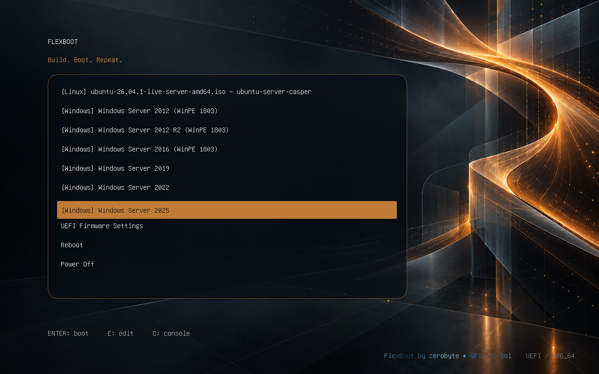
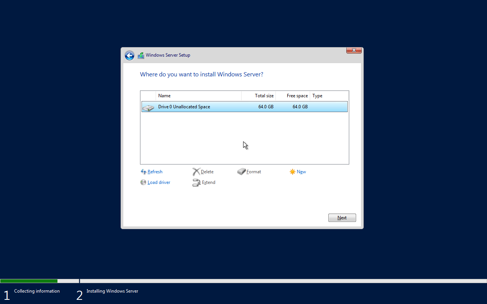
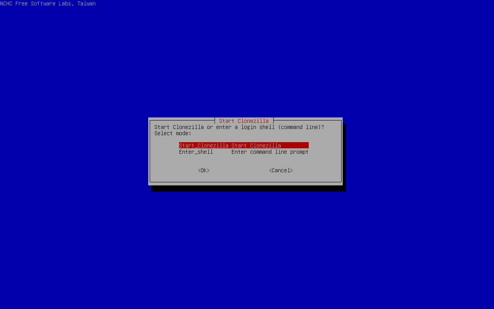

# FlexBoot 0.7.5 — 14-image USB and Server 2025

The media work completed on 2026-10-17 using FlexBoot 0.7.5. This report is
published with the documentation release 0.7.6; it does not claim a new boot-test
run with 0.7.6. ISO files, prepared runtime binaries, backups, credentials and
private lab state are excluded from the public repository.

## Collection and preparation

With explicit owner authorization, the existing 128 GB Samsung FIT USB was
backed up and recreated through the actual FlexBoot CLI. The retained archive
was independently SHA-256 checked after storage on the backup server. All nine
original images, custom labels, menu settings and background were preserved;
filesystem references were rebound to the new UUIDs.

| Partition | Layout |
|---|---|
| Boot | 512 MiB FAT32, Microsoft Basic Data role, removable UEFI GRUB |
| Linux data | Approximately 55 GiB ext4 |
| Windows data | 64 GiB NTFS reserve, plus partition alignment rounding |

The opt-in Windows layout still requires firmware capable of booting a FAT
Basic Data partition. See [Windows requirements](WINDOWS.md).

The final menu contains seven Linux and seven Windows images:

| Group | Images |
|---|---|
| Linux | Clonezilla 3.3.3-37, Fedora 44, Kali 2019.3, Kali 2022.2, Kali 2026.2 Everything, Rescuezilla 2.6.2, Ubuntu Server 26.04.1 |
| Windows | Windows 10 22H2 Swedish; Server 2012, 2012 R2, 2016, 2019, 2022 and 2025 |

Server 2012, 2012 R2 and 2016 use the explicitly selected Windows 10 1803 WinPE
donor. Server 2019, 2022 and 2025 use their native WinPE. The original installer
ISOs remain intact. The added Server 2025 Evaluation x64 source identifies build
26100; its source boot WIM index 2 was inspected and WIM integrity checked.

Full verification passed for all 14 images, including recorded ISO and prepared
resource hashes, Linux profile inspection, and generated-menu consistency.
Approximately 23.55 GiB remained available on Windows storage and 21.97 GiB on
Linux storage. The zerobyte / GPT-6.1-Sol branding was retained.

## Boot evidence from the rebuilt USB

QEMU/OVMF used explicitly read-only physical USB block nodes with a disposable
writable overlay. Installation destinations were owned virtual disk files.
Physical USB write-sector counters remained unchanged across both boot tests.
The screenshots are unedited 1280×800 captures from these runs.

| Image | Result in this pass | Scope |
|---|---|---|
| Server 2025 Standard Evaluation, Desktop Experience | Native Setup reached destination selection and detected a blank 64 GiB virtual disk | Stopped before installation |
| Clonezilla 3.3.3-37 | Reached the live Start Clonezilla interface | No cloning operation started |

Read-only FAT32 and ext4 filesystem checks returned exit code 0. The NTFS basic
`ntfsfix -n` check also returned 0; this is not a full Windows `chkdsk` result.
The verified backup was retained privately, temporary local ISO/archive staging
was removed, and the USB was unmounted after completion.

## Limits and earlier results

This pass verifies stored integrity across the complete collection and boots
Server 2025 and Clonezilla from that collection under emulated firmware. It does
not establish that all 14 entries were booted again after the rebuild, a complete
Server 2025 installation, or any new physical-machine boot result. Locally
recorded hashes do not establish publisher authenticity.

Earlier full installations and destination-only first-run boots for Server
2012, 2012 R2, 2016 and 2019 remain documented in the
[0.7.4 report](TESTING-0.7.4.md) and [0.7.3 report](TESTING-0.7.3.md).
Server 2022 has Setup/destination-detection evidence; no completed Server 2022
installation is claimed here. Earlier user-reported physical boots apply to the
images and media tested at that time, not automatically to this expanded set.

Follow-up candidates are tracked in [possible next steps](ROADMAP.md).

## Documentation release checks

For publication on 2026-10-19, the standard test suite ran 162 tests: 160 passed
and two opt-in loop-image integration tests were skipped because
`FLEXBOOT_RUN_IMAGE_TESTS=1` was not enabled. No physical media was changed.
Python compilation, CLI help for the documented commands, local documentation
links, and matching CLI/package versions (0.7.6) were checked. This documentation
release does not replace the USB's tested 0.7.5 installation.
