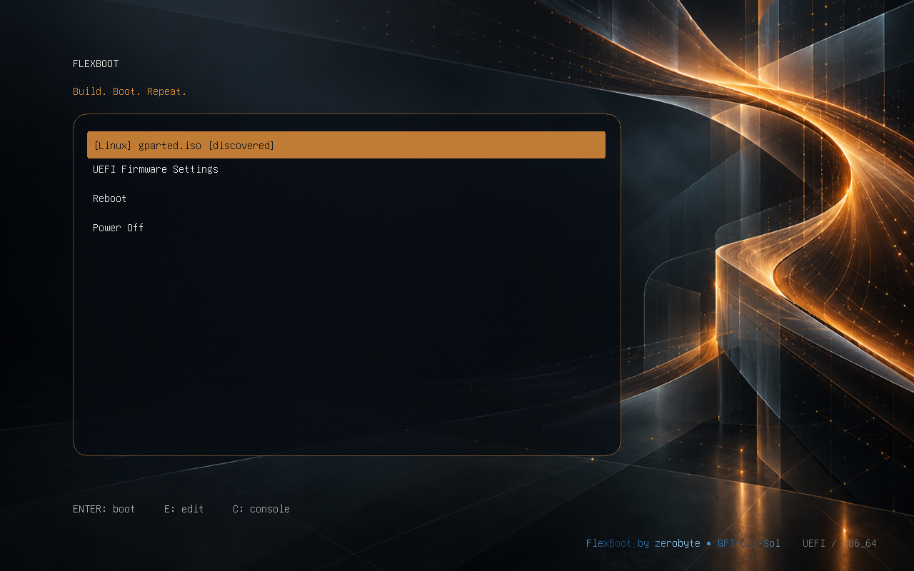
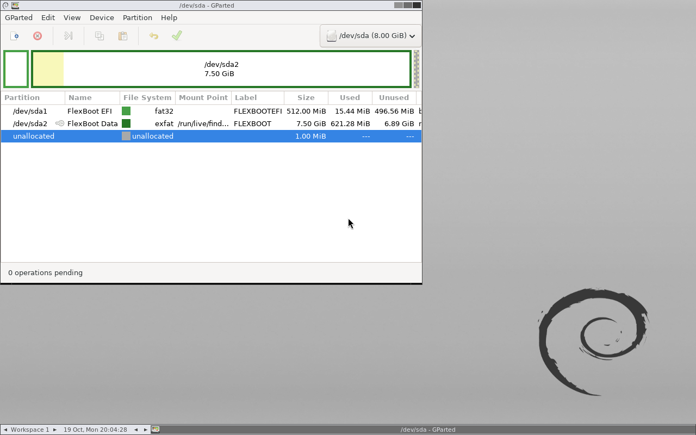
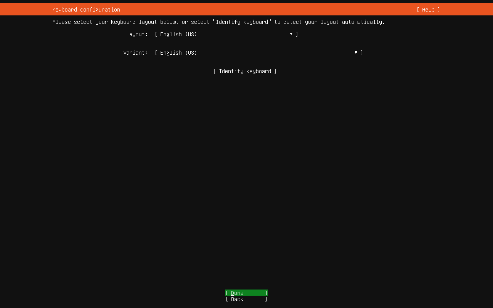

# FlexBoot 0.7.7 — boot discovery and experimental exFAT

Validation completed on 2026-10-19. All new provisioning and boot tests used
owned regular-file images, optional loop devices, and QEMU/OVMF. No physical
storage was formatted or modified. No physical USB was attached for this pass.

## Behavior added

GRUB inspects newly copied ISO files at boot on the configured data filesystem
and the optional Windows NTFS filesystem. Entries appear only for the limited
supported layouts and simple filenames, after managed entries. No host importer
or manifest update is needed. Managed entries retain their labels and ordering.

New drives can explicitly select `--data-filesystem exfat`. Ext4 remains the
default. ExFAT uses a Basic Data GPT partition and host-provided GRUB support;
its formatter and host kernel support are checked before erasure. Windows
installer storage remains NTFS. No runtime download or in-place conversion was
introduced. See [workflow and limits](BOOT-DISCOVERY.md).

## Actual Linux boots

Each source below remained an intact ISO. Boot sources were read-only or protected
by disposable QEMU snapshots. The guests had no network or host physical disks.

| Image | Filesystem containing the ISO | Result |
|---|---|---|
| GParted Live 1.8.1-3 amd64 | ext4 | Discovered without import; reached live keymap configuration |
| GParted Live 1.8.1-3 amd64 | NTFS | Discovered without import; reached live keymap configuration |
| GParted Live 1.8.1-3 amd64 | exFAT | Reached the desktop and GParted application |
| Clonezilla Live 3.3.1-35 amd64 | ext4 | The `--discover` helper reached the live user shell on the serial console |
| Ubuntu Server 24.04.4 amd64 | NTFS | Reached the installer keyboard configuration screen |
| Ubuntu Server 24.04.4 amd64 | exFAT, initial experiment | Kernel/initrd loaded, but Casper could not rediscover the ISO and entered the initramfs shell |

The full exFAT builder test created an 8 GiB GPT image through the actual CLI,
with its removable UEFI GRUB installation, 512 MiB FAT32 ESP and exFAT data
partition. GParted was copied directly into `iso/`; the manifest remained empty.
That image booted to the desktop. After the final configuration fixes, its
configuration was regenerated without importing the ISO, and the complete boot
was repeated successfully. The following captures are from that final run.

The device shown as `/dev/sda` inside GParted is the owned 8 GiB virtual USB
image, not a host physical disk. No partition changes were requested in GParted.

The Ubuntu exFAT failure is a compatibility limit, not a passing boot. Inspection
also found no exFAT module in that source's initrd. Consequently, the final
scanner excludes Casper-based images on exFAT, and managed exFAT imports are
limited to Debian Live, Clonezilla and GParted profiles. A second boot of the
same exFAT/Ubuntu fixture with the final scanner produced no discovered entry.
This is why exFAT remains opt-in rather than becoming the default.

The initial Clonezilla TCG run did not reach the selected UI-text marker before
its timeout. A subsequent accelerated probe reached userspace, but that UI
marker was unsuitable for the serial console. The final helper test used the
observed `user@debian:~$` userspace prompt and passed. No Clonezilla operation or
Ubuntu installation was started. These results do not establish every release
of any family, or a native physical-machine boot.

## Regression and safety checks

- The complete isolated root suite ran **171 tests: 170 passed, one skipped**.
  All three opt-in loop-image integration tests ran, covering default media,
  exFAT management, and explicit Windows provisioning. The skipped test was the
  optional standalone QEMU discovery regression, run separately below.
- The standalone discovery regression ran **four tests successfully**, including
  its actual QEMU/OVMF menu test. Synthetic x86 Linux/EFI headers exercised
  detection, managed-path deduplication, mixed-case extensions, and exclusion of
  32-bit headers, malformed/incomplete images, special filenames and nested files.
  Synthetic images were never booted as operating systems.
- Windows provisioning was additionally tested with both ext4 and exFAT Linux
  data partitions. Both layouts passed inspection and full resource verification.
  This tests provisioning, not a new Windows installation or exFAT Windows storage.
- ExFAT integration exercised add, custom label, sync, verification, remove and
  rejection of filenames requiring symbolic-link aliases. Unknown filesystem
  choices fail before filesystem commands; unavailable host exFAT support is
  reported by preflight. Casper and other unvalidated exFAT families are rejected.
- The empty managed-collection boot tests exposed an invalid empty conditional
  and a validation gap for function-only configuration. Both were corrected;
  generated includes now contain a valid executable command and receive syntax
  validation even when there are no managed menu entries.
- Python compilation, CLI help, read-only device discovery, creation dry-run,
  GRUB syntax and matching package/CLI versions (0.7.7) were checked.

Discovery never writes metadata or records integrity hashes. Managed verification
and unregistered drop files have distinct coverage; see the
[verification explanation](BOOT-DISCOVERY.md#managed-state-and-verification).
No Secure Boot, Windows drop-and-boot, or unified exFAT Windows backend is claimed.

## Exact sources

The following locally calculated hashes identify the tested files; they do not
establish publisher authenticity. Private source storage and backups are not
part of the repository.

- `ubuntu-server.iso` — 3,405,469,696 bytes; SHA-256 `e907d92eeec9df64163a7e454cbc8d7755e8ddc7ed42f99dbc80c40f1a138433`.
- `clonezilla.iso` — 485,490,688 bytes; SHA-256 `ac4f88c8795a917e3d3fc1a3e52d095f35fe531d459cf853cd3e2c7731043fec`.
- `gparted.iso` — 649,068,544 bytes; SHA-256 `3f66b2e10b8bb2c573ed6cdd3a9b54fd0a8e7690634ab6b15c3c8f517992d1a1`.

The private short names above correspond to Ubuntu Server 24.04.4 amd64,
Clonezilla Live 3.3.1-35 amd64, and GParted Live 1.8.1-3 amd64 respectively.
